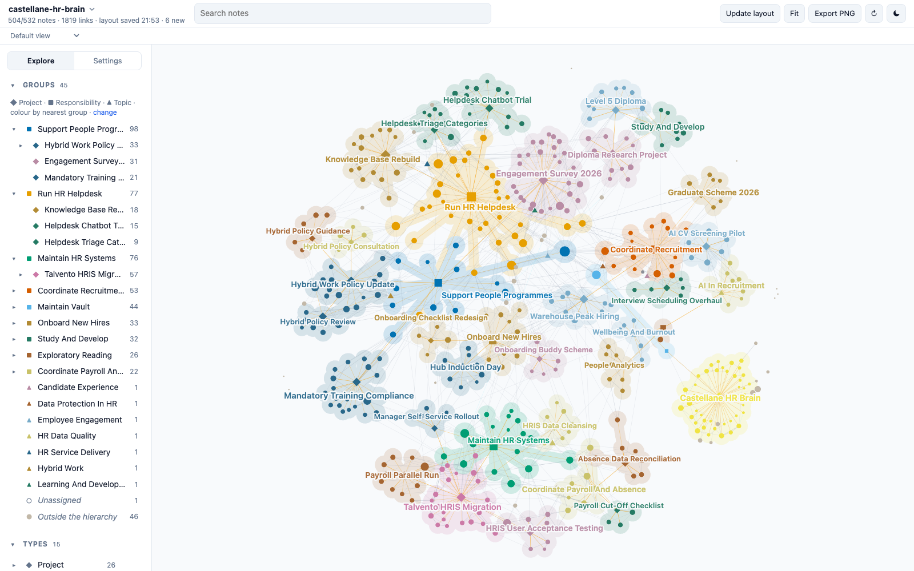

# Castellane HR Brain

A demo Second Brain: about 530 linked Markdown notes holding the working memory of a fictional HR assistant in a large logistics group. Clone it, open the folder, and explore what a vault looks like after two years of daily use: projects, decisions, meetings, people, sources, open questions, and the links between them.



**[Explore this vault in the live demo](https://mfoll.github.io/brain-graph-demo/?vault=castellane-hr-brain)**: its map in Brain Graph, in your browser, with nothing to install.

> [!warning]
> Everything about the company is fictional: Pellmore Logistics Group, every person, its sites, committees, HR systems and vendors, the Guild of People Practice, every policy, survey result and figure. Any resemblance to real people or organisations is accidental. Only the Sources marked as encyclopedia articles, scientific papers or documentation are real.

## Everyday use

Try “Save this useful idea or reference under the relevant project”, “Where did we leave this project?” or “Update what we decided and what comes next”. Inspect what was saved and find it again from the Project. The [template’s practical walkthrough](https://github.com/mfoll/second-brain-template#build-your-first-useful-project) explains how to start your own vault; experiment on a private copy if you want to keep real notes.

Inbox processing is optional deferred capture. Process Inbox handles the requested scope; Ready Ingestion selects only `ingest_ready: true` before following the same processing. A supplied external source can go directly through Ingest Source. Neither an Inbox, Tolaria nor an integration is required. Lint checks structure; health review judges usefulness. The deliberate findings described in this demo remain examples, not defects to repair automatically.

## What it shows

The vault was deployed from the [Second Brain template](https://github.com/mfoll/second-brain-template), which adds operating rules, workflows and a decision record to the [Portent](https://github.com/refactoringhq/portent) note model. Everything is plain files: Markdown notes with YAML frontmatter, typed relationships (`belongs_to`, `related_to`, `has`) and wikilinks. No app, database or index is required.

| Area | What to look at |
| --- | --- |
| Structure | 8 Responsibilities at the root, about 25 Projects under them, 10 Topics as lateral context; every note rolls up to a Responsibility. |
| Memory | About 180 Sources, 50 Events, 35 Questions, 30 Concepts, 15 Opinions, 14 Recaps, 40 people. |
| Real material | About 70 Sources are real public material: Wikipedia articles on HR concepts and data protection, open-access organisational psychology papers cited with DOI and PMID, and public software documentation, summarised in our own words. Their "Why It Matters" sections describe how the fictional HR team uses them. |
| Operations | `AGENTS.md`, Type notes, Procedures, Skills and ADRs from the template, unchanged except for the deployment steps. |
| History | Git history from January 2025 to October 2026, one commit for each month that had captures. |

## Open it

- **Any Markdown editor.** Clone the repository and open the folder; notes sit flat at the root by design. Start from [vault](vault.md).
- **[Tolaria](https://tolaria.md/).** Open the folder as a vault for typed sidebars, relationship panels and saved views.
- **[Brain Graph](https://github.com/mfoll/brain-graph).** See the whole vault as a map coloured by project:

  ```bash
  npx github:mfoll/brain-graph path/to/second-brain-demo-hr-assistant
  ```

- **A coding agent.** Run Claude Code, Codex or Gemini CLI in the folder. They read [AGENTS](AGENTS.md) (through `CLAUDE.md` and `GEMINI.md` where needed) and follow the vault's Procedures.

## Try this

Each question has a known answer in the vault, so you can check what an agent finds.

| Ask | Where the answer lives |
| --- | --- |
| What is our hybrid work rule now, and why did it change? | Three fixed office days were decided in February 2026 and partly revised in July. See [hybrid-policy-review](hybrid-policy-review.md) and [people-committee-2026-07-15](people-committee-2026-07-15.md). |
| Why can't small depots see their own engagement survey results? | A minimum reporting group set on data protection advice, with one HR Business Partner still disagreeing. See [survey-reporting-threshold-decision-2026-06-10](survey-reporting-threshold-decision-2026-06-10.md). |
| Why did Talvento go live in June instead of April? | Testing found absence balances converted wrongly. See [uat-defect-review-2026-03-11](uat-defect-review-2026-03-11.md). |
| When will payroll stop using Staffora? | Still open. See [when-should-payroll-cut-over-to-talvento](when-should-payroll-cut-over-to-talvento.md). |
| Why did we stop the HR chatbot? | The answers were only as good as the articles behind them. See [helpdesk-chatbot-trial](helpdesk-chatbot-trial.md) and [knowledge-base-rebuild](knowledge-base-rebuild.md). |
| What data can my diploma research project use? | Aggregate ticket counts only. See [diploma-research-project](diploma-research-project.md) and [record-hr-cases-without-personal-data](record-hr-cases-without-personal-data.md). |

Workflows to try with an agent:

- **Resume a project:** "Resume the Warehouse Peak Hiring project."
- **Process the Inbox:** about ten raw captures from the last weeks of October 2026 have `_organized: false`; each has an obvious home.
- **Ingest a source:** give any Wikipedia article or open-access paper on onboarding, hybrid work or employee engagement and ask where it belongs.
- **Lint the vault:** the audits should report one link to a missing note and one Concept that belongs to nothing, both left in on purpose. Informational lines, such as external contacts without a parent, are expected.

## Scope and privacy

The fictional HR assistant's recruitment coordination, onboarding, helpdesk, HR systems, payroll and absence data, people programmes, professional studies and reading. No individual employee's or candidate's personal, medical, disciplinary or pay details, no credentials and no personal administration; cases are described by category and point to the HR system that holds them.

## Template updates

The vault was deployed from the template on 2026-10-23. Later template improvements can be brought in with [Upgrade an Existing Vault From the Template](upgrade-existing-vault-from-template.md), as a reviewed change: an agent proposes each change, and a person approves it. Never run it unattended. A vault in use is expected to differ from the template on purpose, in its ADRs, Procedures, Skills and instructions.

## How it was made

An AI agent drafted the world specification (the company, people, projects, timeline and the storylines behind the questions above) and a person reviewed and changed it. AI agents then wrote the notes from it, one per area of the work, and retrieved the real material from Wikipedia, Europe PMC and public documentation. The links, frontmatter, cross-area consistency and source metadata were checked with the template's lint scripts and against the original records.

## Storage and backup

The notes are plain files, and their history is this Git repository. To undo edits made while trying the demo, run `git checkout .`; `git clean -n` lists any new files, which `git clean -f` would delete.

## More example vaults

This is one of nine fictional vaults deployed from the same template, each kept by a different kind of person: a lab head, a café owner, a teacher, a freelance designer, a parent running a household, a sports club chair, a novelist, a start-up engineering lead and an HR assistant. The [template README](https://github.com/mfoll/second-brain-template#example-vaults) lists them all.

## Licence

MIT, see `LICENSE`, which also covers the template material. `THIRD_PARTY_NOTICES.txt` lists upstream notices. Cited sources remain under their own licences; the notes contain only their metadata and our own summaries.
